<table>
  <tr>
    <td width="36%" align="center" valign="middle"></td>
    <td width="64%" align="center" valign="middle">
      <a href="https://ashishraunak.vercel.app">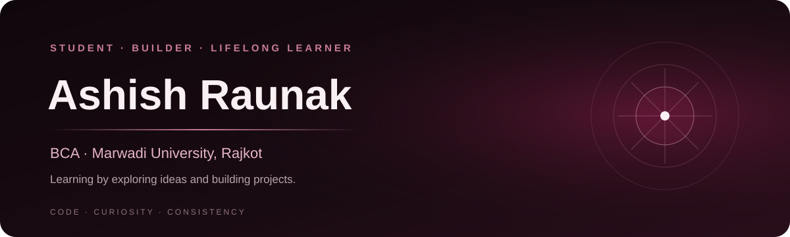</a>
      
<strong>BCA Final-Year Student · Aspiring Software Developer · Web Development Enthusiast</strong>

      

        
        
      

    </td>
  </tr>
</table>

  
  
  
  

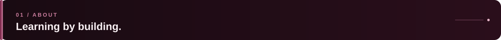
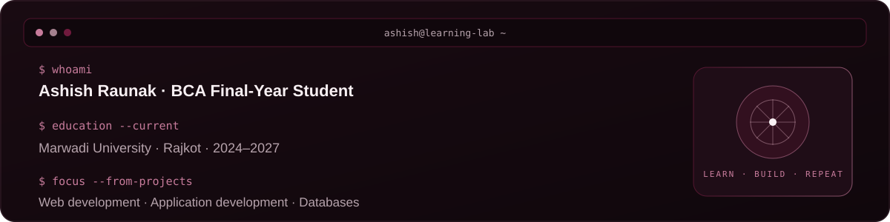
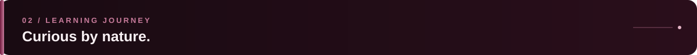
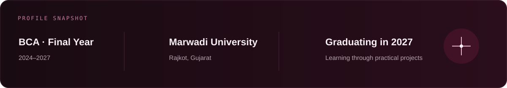

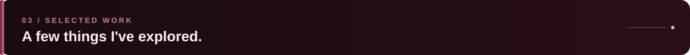
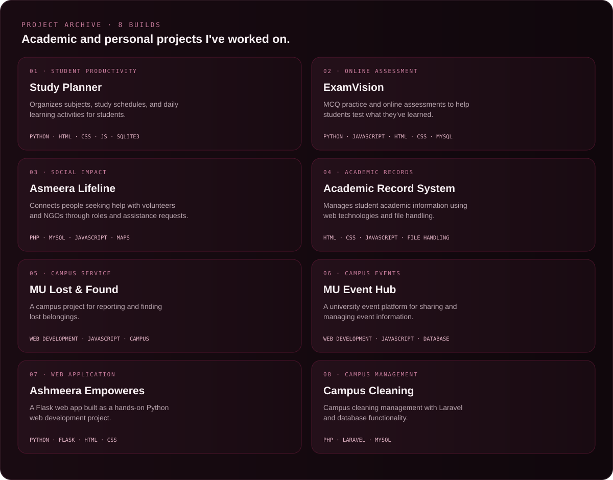

  
  

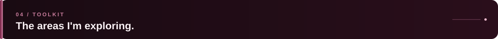
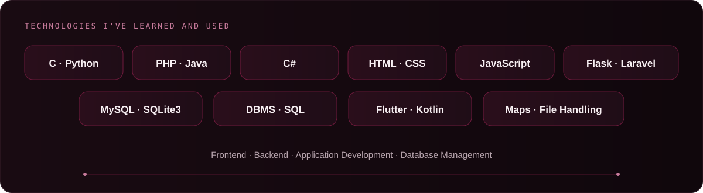

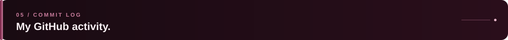
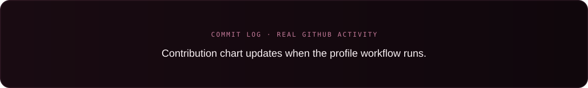

  

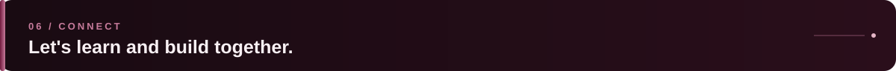

  
  
  

