

<a href="https://ashishraunakthakur.github.io">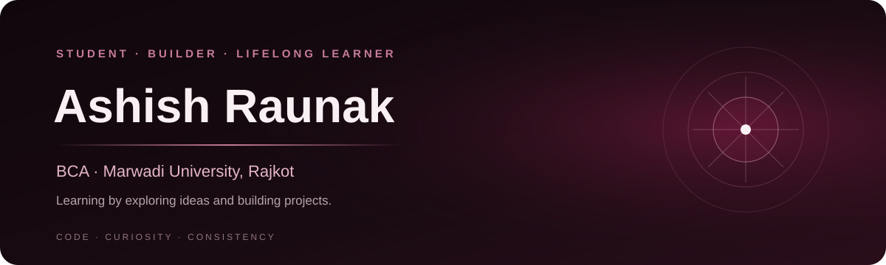</a>

<strong>BCA Final-Year Student · Aspiring Software Developer · Web Development Enthusiast</strong>

  
  
  
  
  
  
  

 


I'm <strong>Ashish Raunak Thakur</strong>, a final-year BCA student at Marwadi University, Rajkot, expected to graduate in 2027. I enjoy learning new technologies and improving my practical skills by building academic and personal projects. My interests include frontend, backend, application development, and databases.

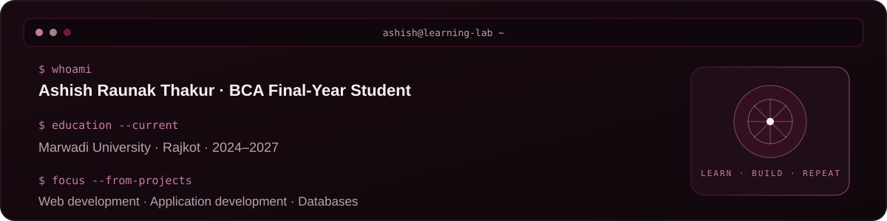

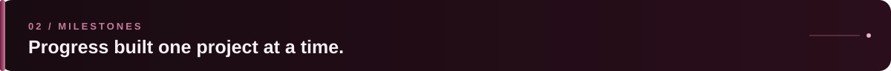
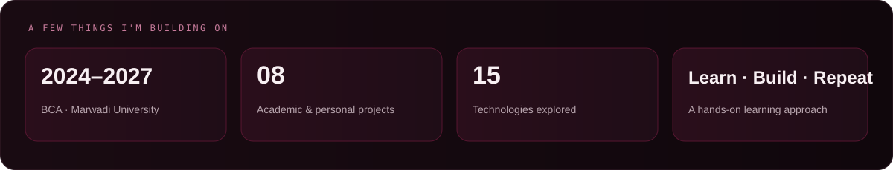

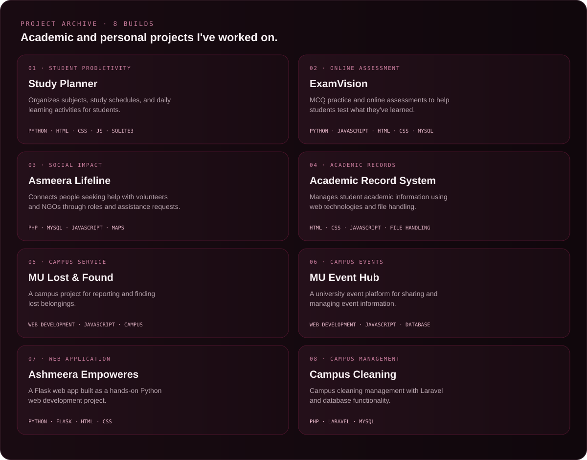

  
  

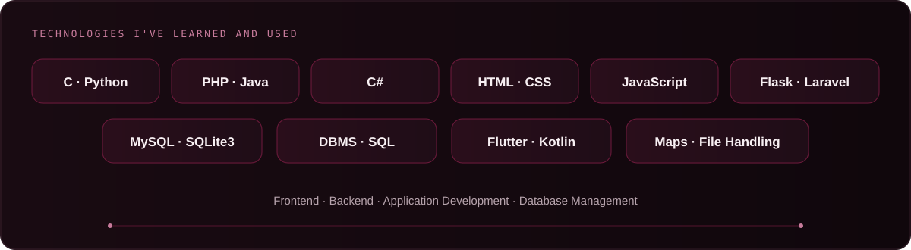

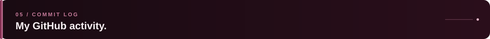

  

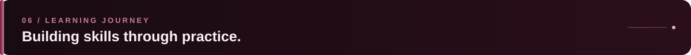

My learning journey is shaped by my BCA studies and hands-on work across eight academic and personal projects. I have explored Python, PHP, Java, C, C#, web development, Flutter, Kotlin, databases, Flask, and Laravel, and continue building my skills one project at a time.

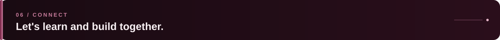

  
  
  
  
  

